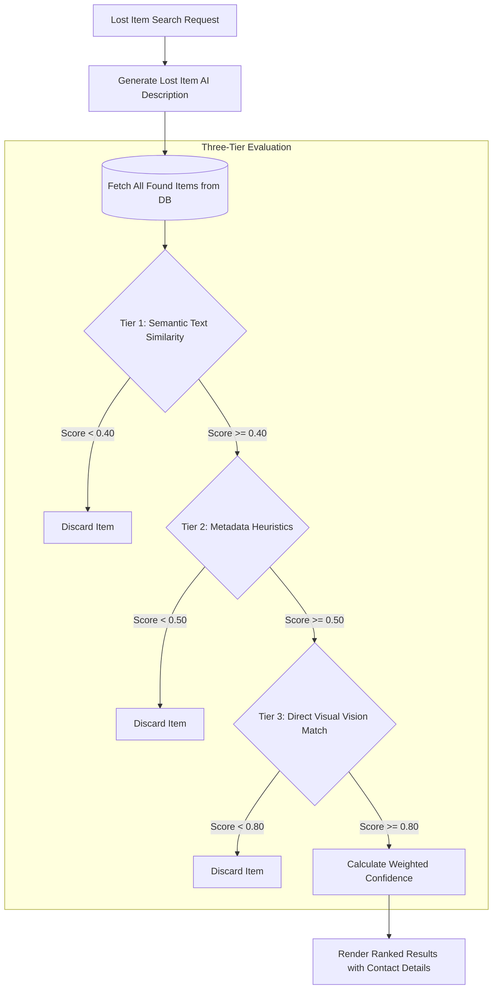

# AI-Powered Lost and Found Platform


[](https://www.python.org/)
[](https://flask.palletsprojects.com/)
[](https://ai.google.dev/)
[](https://www.sqlite.org/)
[](https://getbootstrap.com/)
[](https://opensource.org/licenses/MIT)

A full-stack intelligent web application that reunites lost personal belongings with their rightful owners using multimodal computer vision and semantic reasoning powered by the Google Gemini API.

---

## Overview

Traditional lost-and-found portals depend heavily on exact keyword searches, leading to missed connections when search keywords differ from report descriptions (for instance, "dark leather wallet" versus "black bi-fold cardholder").

This platform overcomes keyword limitations through a multimodal perception pipeline:

1. **Automatic Visual Captioning**: Inspects photos uploaded by finders and losers to extract structured physical attributes, colors, brand logos, materials, and distinct wear patterns.
2. **Three-Tier Intelligent Matching Engine**: Filters candidates progressively through semantic description comparison, metadata heuristics, and direct image-to-image computer vision.
3. **Transparent Match Scoring**: Delivers confidence scores with a granular breakdown of description, metadata, and visual similarity percentages.


---

## Key Capabilities

### 1. Found Item Reporting (`/report_found`)
* Finders upload an image of the discovered item along with category, location found, and contact information.
* Google Gemini generates an objective visual description focused strictly on the item while eliminating conversational preambles and background noise.
* Records and uploaded media are persisted securely to SQLite and local storage.

### 2. Lost Item Search (`/search_lost`)
* Owners submit a reference image or original photograph along with category and last-known location.
* The system analyzes the search image, computes visual features, and queries candidate items from the database.
* The system evaluates each candidate using the three-tier similarity pipeline and outputs ranked results sorted by match confidence.

### 3. Developer Admin Dashboard (`/admin`)
* Dedicated control panel to inspect all reported items, metadata, timestamps, and generated descriptions.
* Single-item deletion that removes the database record and cleans up the associated media file from disk to prevent orphaned storage.
* Bulk database reset capability to clear all records and uploaded assets during testing cycles.

### 4. Interactive User Experience
* Visual progress feedback: Form submission buttons dynamically transition into circular looping spinners (`spinner-border`) to indicate background AI analysis and prevent duplicate requests.
* Markdown typography: AI descriptions render bold attributes, headers, and bulleted lists cleanly instead of displaying raw markdown characters.


---

## Three-Tier Matching Architecture



### Confidence Formulation

When candidate items successfully satisfy all three tier thresholds, a composite confidence index is computed:

$$\text{Confidence} = (0.30 \times S_{\text{description}}) + (0.30 \times S_{\text{metadata}}) + (0.40 \times S_{\text{image}})$$

* **Description Similarity ($S_{\text{description}}$)**: Evaluated by Gemini analyzing whether both text descriptions represent the same physical item or product model.
* **Metadata Proximity ($S_{\text{metadata}}$)**: Weighted heuristic evaluation across item category, color match, brand, and reported location.
* **Visual Similarity ($S_{\text{image}}$)**: Direct image-to-image evaluation by Gemini Vision focusing on geometry, colors, unique markings, and hardware layout.

---

## Technical Specifications

| Layer | Component | Description |
| :--- | :--- | :--- |
| **Backend** | Python 3.9+ / Flask | Core application server, routing, file management |
| **Database** | SQLite3 & Flask-SQLAlchemy | Relational database storing item entities and timestamps |
| **Multimodal AI** | Google Gemini (`gemini-3.1-flash-lite`) | Image description, semantic similarity, and visual comparison |
| **Image Processing** | Pillow (PIL) | Pre-processing, color conversion, and image handling |
| **Markdown Parsing**| markdown-it-py / MarkupSafe | Formats AI outputs into sanitized HTML structures |
| **Frontend** | HTML5, Jinja2, Bootstrap 5 | Responsive UI with modal states and progress indicators |
| **Configuration** | python-dotenv | Environment variable management for API keys and secrets |

---

## Project Structure

```text
lost-and-found-app/
├── app.py              # Main Flask application, routes, and Gemini integration
├── config.py           # Configuration values, API keys, thresholds, model settings
├── models.py           # SQLAlchemy database schema and metadata helpers
├── requirements.txt    # Project dependencies
├── .env.example        # Template for environment variables
├── .gitignore          # Excludes uploads, databases, and sensitive credentials
├── static/
│   └── css/
│       └── style.css   # Custom presentation and markdown layout styling
├── templates/
│   ├── base.html       # Base layout, navbar, flash messages, submit spinner script
│   ├── index.html      # Landing page with primary navigation actions
│   ├── report_found.html # Found item reporting form
│   ├── search_lost.html  # Lost item search form
│   ├── results.html    # Ranked match results with score breakdowns
│   └── admin.html      # Developer management dashboard for record deletion
├── uploads/            # Storage directory for uploaded images (persisted with .gitkeep)
└── instance/           # Local SQLite database directory (items.db)
```

---

## Installation and Setup

### Prerequisites
* Python 3.9 or higher installed
* Google AI Studio API key ([Obtain key from Google AI Studio](https://aistudio.google.com/))
* Git

### 1. Clone the Repository
```bash
git clone https://github.com/vanshtyagi001/lost-and-found-app.git
cd lost-and-found-app
```

### 2. Create and Activate Virtual Environment
* **On Windows (PowerShell):**
  ```powershell
  python -m venv .venv
  .\.venv\Scripts\Activate.ps1
  ```
* **On macOS / Linux:**
  ```bash
  python3 -m venv .venv
  source .venv/bin/activate
  ```

### 3. Install Dependencies
```bash
pip install -r requirements.txt
```

### 4. Configure Environment Variables
Copy `.env.example` to create a `.env` file in the project root:
```bash
cp .env.example .env
```

Edit `.env` and provide your credentials:
```ini
# Google Gemini API Keys (Single key or separate keys for text and vision)
GEMINI_TEXT_API_KEY=your_gemini_api_key_here
GEMINI_IMAGE_API_KEY=your_gemini_api_key_here

# Optional: Fallback unified key
# GEMINI_API_KEY=your_gemini_api_key_here

# Flask secret key for session signing
FLASK_SECRET_KEY=generate_a_random_secret_key_here

# Optional: Override default Gemini model
GEMINI_MODEL_NAME=gemini-3.1-flash-lite
```

### 5. Start the Application Server
```bash
python app.py
```

The application will initialize the SQLite database automatically and start on:
```text
http://127.0.0.1:5000
```

---

## Configuration Reference

Matching thresholds and application constants can be customized in `config.py` or `.env`:

| Parameter | Default | Purpose |
| :--- | :--- | :--- |
| `DESCRIPTION_SIMILARITY_THRESHOLD` | `0.40` | Minimum score required in Tier 1 to proceed to metadata check |
| `METADATA_SIMILARITY_THRESHOLD` | `0.50` | Minimum score required in Tier 2 to proceed to image check |
| `IMAGE_SIMILARITY_THRESHOLD` | `0.80` | Minimum visual confidence in Tier 3 to declare a match |
| `GEMINI_MODEL_NAME` | `gemini-3.1-flash-lite` | Gemini model variant used for generation and inference |
| `MAX_CONTENT_LENGTH` | `16 MB` | Maximum allowed file upload size |

---

## Administrative Functions

The platform provides a developer route at `/admin`:

* **Access URL**: `http://127.0.0.1:5000/admin`
* **Single Item Deletion**: Removes the database record and deletes the corresponding image from `uploads/`.
* **Database Reset**: Removes all records and purges non-git assets from the `uploads/` directory.

---

## Production Deployment Recommendations

1. **WSGI Application Server**: Run behind a production WSGI server such as Gunicorn or Waitress rather than Flask development server:
   ```bash
   gunicorn -w 4 -b 0.0.0.0:5000 app:app
   ```
2. **Reverse Proxy & TLS**: Deploy behind Nginx or Cloudflare with SSL/TLS termination enabled.
3. **Database Migration**: For enterprise workloads, replace SQLite with PostgreSQL by updating `DATABASE_URI` in `config.py`.
4. **Object Storage**: For distributed cloud hosting, forward image storage from local `uploads/` to AWS S3, Google Cloud Storage, or Azure Blob Storage.
5. **Contact Anonymization**: Consider replacing direct contact information with an in-platform relay or ticketing service to protect user privacy.

---

## License

This project is licensed under the MIT License. See the [LICENSE](LICENSE) file for full details.
